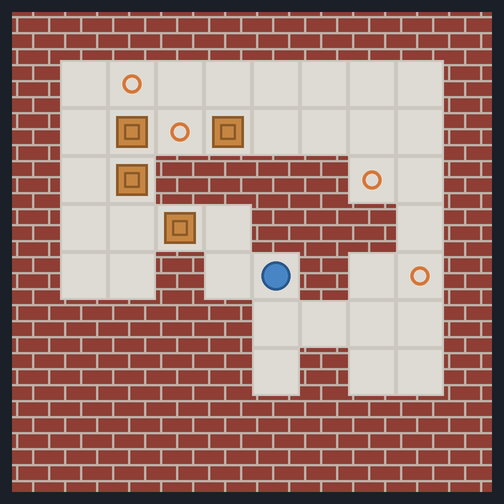
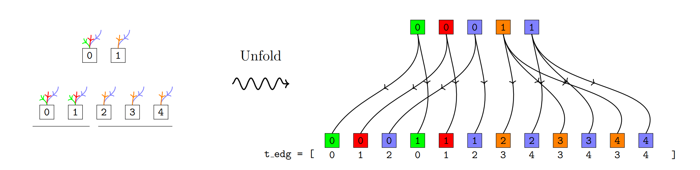
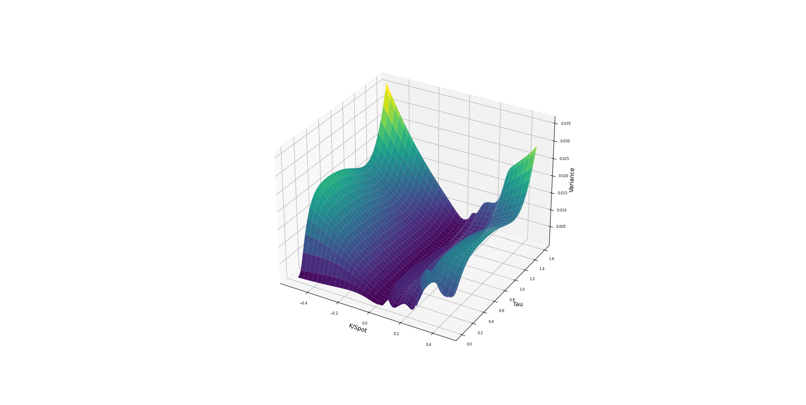

I am a **research engineer and former mathematician** with a passion for translating advanced mathematical and computational methods into real-world applications. My professional background spans **data science, machine learning research, and quantitative analysis**.

I earned my PhD in Mathematics from the [University of Waterloo](https://uwaterloo.ca/) in 2021, and I hold both a master's and a bachelor's degree in Mathematics from [Sharif University of Technology](https://en.sharif.edu/). My [PhD research](https://uwspace.uwaterloo.ca/handle/10012/16872) focused on stochastic optimization, while my earlier studies delved into fundamental mathematics.

Recently I have been working on generative models for combinatorial puzzles, GPU-accelerated game solving, and deep learning for option pricing. You can read more about my [projects](/projects/) or download my [CV](/files/resume.pdf).

    <h3>Recent News &amp; Highlights</h3>
    <ul class="news-list">
        <li>
            Aug 2026
            

                Released <a href="https://arxiv.org/abs/2608.15958">Solvable Sokoban Without a Solver via Diffusion</a>: a 4.9M-parameter masked diffusion model that generates puzzles that are 77.4% solvable with no solver or reward in training (<a href="/sokoban/">project page</a>).
            

        </li>
        <li>
            Oct 2025
            

                Wrote lecture notes on the <a href="/files/rl.pdf">Basics of Reinforcement Learning</a>.
            

        </li>
        <li>
            Aug 2025
            

                Released <a href="https://arxiv.org/abs/2508.06559">Solving Pasur Using GPU-Accelerated Counterfactual Regret Minimization</a> (<a href="/pasur/">project page</a>).
            

        </li>
        <li>
            Nov 2024
            

                <a href="/vae4heston/">Generative modeling of Heston volatility surfaces</a> with variational autoencoders.
            

        </li>
        <li>
            Aug 2024
            

                Implementation of <a href="/deepsmoothing/">deep smoothing for implied volatility surfaces</a>.
            

        </li>
    </ul>

## Selected Projects

    
    

        <h3>Solvable Sokoban Without a Solver via Diffusion</h3>
        
A masked discrete diffusion model trained only on tile completion generates Sokoban puzzles that are 77.4% solvable, and 98.7% after a single-wall repair.

        

            <a href="https://arxiv.org/abs/2608.15958">Paper</a>
            <a href="/sokoban/">Project page</a>
            <a href="https://github.com/sinabaghal/Sokoban">Code</a>
        

        
Diffusion ModelsTransformersGenerative AI

    

    
    

        <h3>Solving Pasur Using GPU-Accelerated Counterfactual Regret Minimization</h3>
        
A CUDA-accelerated framework for simulating the card game Pasur and computing near-Nash equilibria with CFR.

        

            <a href="https://arxiv.org/abs/2508.06559">Paper</a>
            <a href="/pasur/">Project page</a>
            <a href="https://github.com/sinabaghal/pasur">Code</a>
        

        
CFRGame TheoryGPUPyTorch

    

    
    

        <h3>Generative Modeling of Heston Volatility Surfaces Using VAEs</h3>
        
A variational autoencoder that generates new Heston volatility surfaces for pricing exotic derivatives.

        

            <a href="/vae4heston/">Project page</a>
            <a href="https://github.com/sinabaghal/VariationalAutoEncoderforHeston">Code</a>
        

        
VAEGenerative AIHeston

    

    
    

        <h3>Deep Smoothing for Implied Volatility Surfaces</h3>
        
Neural networks that fit market data while keeping the implied volatility surface arbitrage-free.

        

            <a href="/deepsmoothing/">Project page</a>
            <a href="https://github.com/sinabaghal/deepsmoothigIVS">Code</a>
        

        
Deep LearningVolatility SurfacesSSVI

    

See all projects, including my solutions to Shreve's *Stochastic Calculus for Finance II* and my PhD work on SGD termination criteria, on the [projects page](/projects/).

## Notes

- [Basics of Reinforcement Learning](/rl/)
- Quantitative finance: [Shreve solutions](/shreve/), [Exotic Options](/pages/exotic_options/), [Feynman-Kac Theorem](/pages/feyman_kac/), [Dupire's Formula](/pages/dupire/), [Implied Volatility](/pages/implied_volatility/)

See all of them on the [notes page](/notes/).
