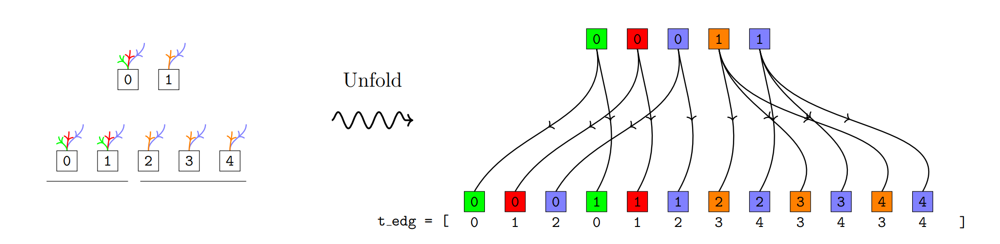
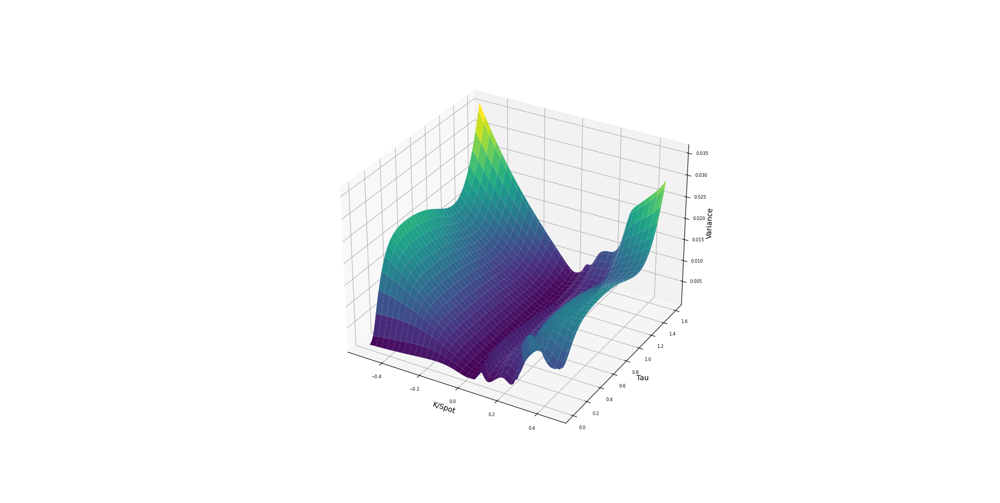
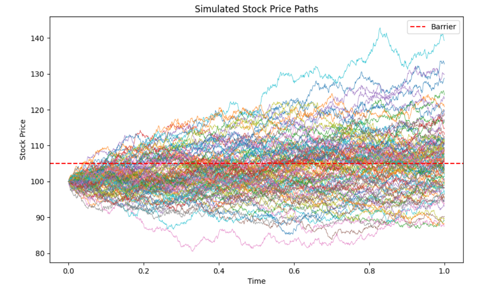
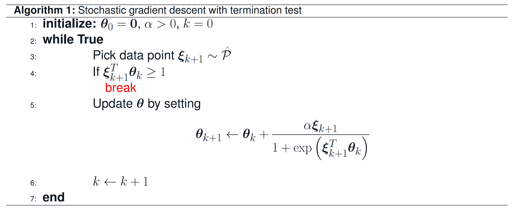

<section class="writeup" markdown="1">

### Solvable Sokoban Without a Solver via Diffusion

Sokoban is a single-player puzzle in which a worker pushes boxes onto goal squares, and deciding whether a given puzzle can be solved at all is [PSPACE-complete](https://en.wikipedia.org/wiki/PSPACE-complete).

This project trains a 4.9M-parameter masked discrete diffusion model to generate Sokoban puzzles from scratch, using nothing but a per-cell tile-completion objective: no solver, no reward, and no solvability label ever enters training. Despite never being shown whether a puzzle is playable, the model produces puzzles that are 77.4% solvable unfiltered, rising to 98.7% once failures repairable by deleting a single wall are counted.

<a href="https://arxiv.org/abs/2608.15958">Paper</a><a href="/sokoban/">Project page</a><a href="https://github.com/sinabaghal/Sokoban">Code</a>

<figure>
  
  <figcaption>Nine puzzles generated from a fully masked grid: 100 steps, one cell committed per step in uniformly random order, never revised.</figcaption>
</figure>

Discrete DiffusionTransformersGenerative AIPyTorch

</section>

<section class="writeup" markdown="1">

### Solving Pasur Using GPU-Accelerated Counterfactual Regret Minimization

Pasur is a fishing card game played over six rounds, similar to games such as Cassino, Scopa, and Bastra. This paper introduces a CUDA-accelerated computational framework for simulating Pasur, emphasizing efficient memory management. We use our framework to compute near-Nash equilibria via Counterfactual Regret Minimization (CFR), a well-known algorithm for solving large imperfect-information games.

<a href="https://arxiv.org/abs/2508.06559">Paper</a><a href="/pasur/">Project page</a><a href="https://github.com/sinabaghal/pasur">Code</a>

<figure></figure>

Counterfactual Regret MinimizationReinforcement LearningPyTorchNash EquilibriumGame TheoryGPU Optimization

</section>

<section class="writeup" markdown="1">

### Generative Modeling of Heston Volatility Surfaces Using Variational Autoencoders

This project trains a Variational Autoencoder (VAE) to produce Heston volatility surfaces. The Heston model is a stochastic volatility model used in option pricing. Once trained, the VAE can generate new volatility surfaces, which is useful for financial applications such as pricing exotic derivatives.

<a href="/vae4heston/">Project page</a><a href="https://github.com/sinabaghal/VariationalAutoEncoderforHeston">Code</a>

<figure></figure>

Variational AutoencoderPyTorchGenerative AIHestonMonte Carlo Simulation

</section>

<section class="writeup" markdown="1">

### Implementing Deep Smoothing for Implied Volatility Surfaces

This project is a Python implementation of the methods in the paper [*Deep Smoothing of the Implied Volatility Surface*](https://arxiv.org/pdf/1906.05065), with the neural network training, convergence behavior, and implementation details developed independently.

A volatility surface represents implied volatility across strike prices and maturities and is crucial for pricing and hedging options accurately. The surface must be arbitrage-free; otherwise it implies riskless profit opportunities and the model is unreliable in real markets. Deep smoothing uses deep learning to generate smooth, arbitrage-free implied volatility surfaces. Given a set of market points $$(k, \tau, iv)$$ that lie on a 3D surface, we construct the surface with two objectives:

- Fit the market data.
- Satisfy certain curvature properties. In quantitative finance this means the surface is arbitrage-free; mathematically, it means minimizing a specified loss function over the whole surface.

<a href="/deepsmoothing/">Project page</a><a href="https://github.com/sinabaghal/deepsmoothigIVS">Code</a>

<figure></figure>

Deep LearningPyTorchVolatility SurfacesSSVIConvex Optimization

</section>

<section class="writeup" markdown="1">

### Quantitative Finance and Option Pricing

Once upon a time, I became interested in quantitative finance, in particular option pricing. Option pricing uses stochastic models in which the uncertainty is driven by a class of continuous-time martingales known as [Wiener processes](https://en.wikipedia.org/wiki/Wiener_process). The classic source for learning how options are priced is Shreve's *Stochastic Calculus for Finance II*. I typed up my own solutions to all of the book's exercises.

<a href="/shreve/">Solutions</a>

<figure></figure>

</section>

<section class="writeup" markdown="1">

### A Termination Criterion for Stochastic Gradient Descent for Binary Classification

Early stopping rules and termination criteria play a central role in machine learning. Models trained with first-order methods without early stopping may predict poorly on future data because they over-fit the given samples. For my PhD project, I worked on a simple and computationally inexpensive termination criterion that predicts well on unseen data, with theoretical and numerical evidence for its effectiveness. I presented the results at [OPT2020](https://opt-ml.org/oldopt/opt20/papers.html) (Workshop on Optimization for Machine Learning at NeurIPS).

<a href="https://opt-ml.org/oldopt/posters/2020/poster_7.pdf">Poster</a><a href="https://uwspace.uwaterloo.ca/handle/10012/16872">PhD thesis</a>

<figure></figure>

Stochastic Gradient DescentLogistic RegressionBinary ClassificationEarly StoppingMarkov Chains

</section>
